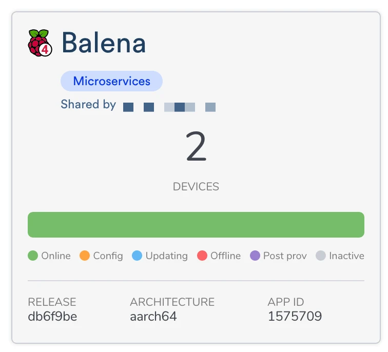
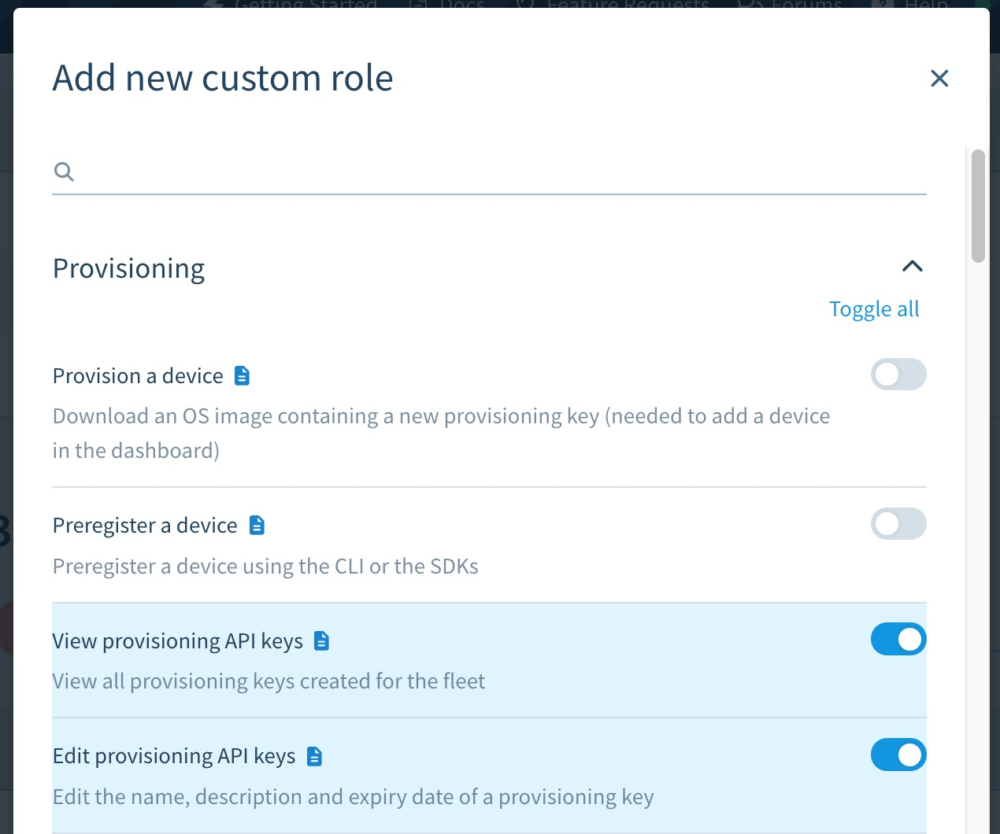

# Fleet members

BalenaCloud offers the ability to collaborate with other users on the platform by inviting members to your fleets, apps or blocks and assigning them a varying degree of access as per your requirement using Member types. To invite members to your organization, refer to [organization management](organizations.md#granting-access-to-fleets).

When a fleet needs to be shared with more than one user, the fleet owner can add new members. With paid accounts, it's possible to assign a level of access for a new member, based on the following types:

### Member types

<table data-search="false"><thead><tr><th>Member Access</th><th data-type="checkbox">Observer</th><th data-type="checkbox">Operator</th><th data-type="checkbox">Developer</th><th data-type="checkbox">Administrator</th></tr></thead><tbody><tr><td><a href="organizations.md#managing-roles-and-access-in-an-organization">Add Members</a></td><td>false</td><td>false</td><td>false</td><td>true</td></tr><tr><td>Delete App</td><td>false</td><td>false</td><td>false</td><td>true</td></tr><tr><td>Add/Remove device</td><td>false</td><td>true</td><td>true</td><td>true</td></tr><tr><td>Manage provisioning keys</td><td>false</td><td>true</td><td>true</td><td>true</td></tr><tr><td><a href="../manage/actions.md">Device specific actions</a></td><td>false</td><td>true</td><td>true</td><td>true</td></tr><tr><td><a href="../manage/filters-tags.md">Tags</a></td><td>false</td><td>true</td><td>true</td><td>true</td></tr><tr><td><a href="../manage/variables.md">Variables</a></td><td>false</td><td>true</td><td>true</td><td>true</td></tr><tr><td><a href="../manage/ssh-access.md">SSH access</a></td><td>false</td><td>true</td><td>true</td><td>true</td></tr><tr><td><a href="../deploy/deployment.md#balena-push">Push</a></td><td>false</td><td>false</td><td>true</td><td>true</td></tr><tr><td><a href="../manage/configuration.md">Configuration</a></td><td>false</td><td>false</td><td>true</td><td>true</td></tr><tr><td><a href="../manage/actions.md">Fleet specific actions</a></td><td>false</td><td>false</td><td>true</td><td>true</td></tr></tbody></table>

#### Administrator

A new fleet in balenaCloud can only be created by an [administrator](organizations.md#managing-roles-and-access-in-an-organization) of an organization. Administrators are the only users who can add other fleet members or delete the fleet. Learn more about the [administrator role](organizations.md#managing-roles-and-access-in-an-organization) in an organization. .png>)

#### Observer

Observers are given read-only access to the fleet and its devices. They are not able to modify, add, or remove any devices, nor are they able to perform device actions. This role can only be assigned by fleet owners on paid plans.

#### Operator

Operators have all the access given to observers, plus the ability to manage a fleet's devices. This means operators can add and remove devices, generate & revoke provisioning API keys, perform device actions, and modify device tags, metadata, and environment variables. Operators also have full [SSH access](../manage/ssh-access.md) to the fleet's devices. This role can only be assigned by fleet owners on paid plans.

#### Developer

Developers are given, in addition to the access provided to operators, the ability to manage fleet software. This includes creating new releases, modifying fleet variables, and downloading balenaOS images. This role is the closest to a fleet owner—developers can do everything owners can except for deleting the fleet or adding new members. The Developer role can be assigned by fleet owners on free or paid accounts.

### Add a fleet member

To add a new member to your fleet, click on the _Members_ tab of the fleet:

<figure><figcaption></figcaption></figure>

This brings up a list of all fleet members, if any have been assigned. Click on the _Add member_ button in the top left:

<figure><figcaption></figcaption></figure>

The _Add member_ dialog has a dropdown with descriptions of the member types, as well as information about which types are available based on your billing plan. Choose a level of access, then enter the email address of the new member:

<figure><figcaption></figcaption></figure>


Fleet members must have already signed up for a balena account before they can be added to a fleet.


After you click _Add_, you will see the new member in the "Pending invitations" list. From here, you can edit access levels or remove the user if necessary.

All users that have been added to a fleet will see that fleet in their dashboard, with an indicator to designate it has been shared by the fleet owner:

<figure><figcaption></figcaption></figure>

Fleet members will have the option to remove themselves from a fleet by clicking on the members tab, selecting the checkbox by their name from the member list, clicking on the _Modify_ button, and selecting _Delete member_.


If you remove your member access to a fleet, you will not be able to undo the action. Only the fleet owner will be able to restore your access.


### Custom roles for fleets

You can create more granular permissions for fleet or block members by creating a custom role. These custom roles are managed at the organization level and assigned to members via the members tab of a fleet or a block.&#x20;


This feature is only available on [Prototype, Pilot, and Production plans](https://balena.io/pricing/).


#### Creating a custom role

You can add, view, and delete custom roles from the "Fleet roles" tab under an organization.

Click on the "Add new custom role" button under the "Custom Roles" section of the page. After you provide a name and description for your new custom role, you'll have the option to use an existing role as a template for your new role. This is the recommended method though you can also elect to start from scratch.

<figure><figcaption></figcaption></figure>

You can select which permissions the role will have from among a long list. Simply click the switch next to the desired permission to enable or disable it. When you are finished, click the "Review" button at the bottom of the page. At that point you will see all the properties of your new custom role. You can either go back and make changes, or click "Add new role" to finalize the role. You can always go back later and make changes.

#### Editing custom fleet role permissions

To edit the permissions of an existing custom role, click on your role in the "Custom Roles" list from the organizations "Fleet roles" tab. That will load a summary of your custom role. In the "Permissions" section of the page, click on "Manage permissions" to edit the permissions for the selected role.

<figure><figcaption></figcaption></figure>

#### Editing or deleting a custom fleet role

When you click on a role listed in the "Custom Roles" section of the "Fleet roles" it loads the role summary page. In addition to editing the role permissions as described above, you can also edit the role name and description. This is accomplished by hovering your pointer over the name or description to reveal a pencil icon. Clicking on this icon will allow you to edit the selected field.

<figure><figcaption></figcaption></figure>

At the bottom of this section is the "Delete role" button. When you delete a custom role, any members or teams that were assigned to the deleted role will be removed from fleets that utilized that role.

#### Assigning a custom fleet role to a member or team

Once you have created a fleet role, you can assign it to members of a fleet. Select your fleet and then click the "Members" menu item.

<figure><figcaption></figcaption></figure>

On the members page, to assign a custom role to an existing member, select the check box next to the member's name and then click the "Modify" dropdown. From the dropdown menu, select "Edit access".

<figure><figcaption></figcaption></figure>

Once you select "edit access" an "Edit access" popup form will allow you to select the role you want to assign to the member, including any custom fleet roles you have added to the organization. Note that you may need to scroll down the list to see the available custom roles.

To assign roles to a new member not already a part of the fleet, click the "Add member" button. The "Invite fleet member" popup will be displayed where you can enter the email address of the invitee as well as select a custom role from the radio buttons.
